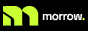

<!-- Monogram, floated right on wider screens -->
<picture>
  <source media="(min-width: 1150px) and (prefers-color-scheme: light)" height="160" srcset="./assets/morrow-monogram-on-light.svg">
  <source media="(min-width: 1150px)" height="160" srcset="./assets/morrow-monogram-on-dark.svg">
  <source media="(min-width: 600px) and (prefers-color-scheme: light)" height="100" srcset="./assets/morrow-monogram-on-light.svg">
  <source media="(min-width: 600px)" height="100" srcset="./assets/morrow-monogram-on-dark.svg">
  
</picture>

<!-- Morrow wordmark -->
<picture>
  <source media="(prefers-color-scheme: dark)" srcset="./assets/morrow-wordmark-on-dark.svg">
  <source media="(prefers-color-scheme: light)" srcset="./assets/morrow-wordmark-on-light.svg">
  
</picture> 

**Technology for a better tomorrow.**

We're Morrow, an independent, community-driven open technology initiative. We build [free and open-source software](https://morrow.jsemolik.dev/#what-we-do) and offer [free hosting](https://morrow.jsemolik.dev/#hosting) for eligible open-source projects.

Technology moves forward when people can learn, build, share and contribute. Morrow exists to lower barriers, not create new ones.

Everything we make is useful, open and human: it solves real problems, it's built in the open, and it keeps complicated things approachable.

Our first repositories are on the way. Follow the organization to see new projects as soon as they're published.

 

### Get involved

<table>
  <tr>
    <th align="left" width="235">What</th>
    <th align="left">Details</th>
  </tr>
  <tr>
    <!-- Free hosting -->
    <td>
      <b>Free hosting</b> 
      <a href="https://morrow.jsemolik.dev/#hosting"><code>Learn more ➜</code></a>
    </td>
    <td>
      Eligible open-source projects get hosting at no cost, so maintainers can spend their time on code, not invoices. We look for projects that are public under an OSI-approved license, actively maintained in the open, and fair to the shared resources other projects rely on. <a href="mailto:morrow@jsemolik.dev?subject=Free%20hosting%20application">Tell us about your project.</a>
    </td>
  </tr>
  <tr>
    <!-- Open source -->
    <td>
      <b>Open source</b> 
      <a href="https://morrow.jsemolik.dev/#open-source"><code>Learn more ➜</code></a>
    </td>
    <td>
      Everything we make is published here on GitHub. Use it, fork it, open an issue, or send a pull request. Newcomers are always welcome.
    </td>
  </tr>
  <tr>
    <!-- Brand -->
    <td>
      <b>Brand guidelines</b> 
      <a href="https://morrow.jsemolik.dev/brand"><code>Learn more ➜</code></a>
    </td>
    <td>
      Writing about Morrow or linking to us? Logos, colors, typography and the full brand kit are in our brand guidelines.
    </td>
  </tr>
</table>

 

&nbsp;
Link to us from your site with an <a href="https://morrow.jsemolik.dev/brand#buttons">88×31 button</a>.
